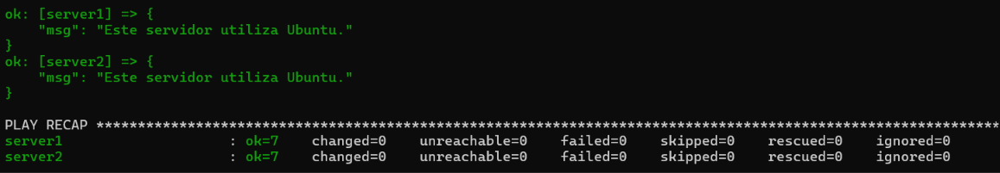

# Laboratorio Ansible + Docker

## Objetivo

Crear un laboratorio con dos servidores Linux utilizando Docker y administrarlos mediante Ansible.

En esta práctica se utilizaron inventarios, módulos, variables, loops y condiciones para automatizar tareas en servidores Ubuntu 24.04.

## Tecnologías utilizadas

- WSL 2 (Ubuntu)
- Docker Desktop
- Docker Compose
- Ansible
- Ubuntu 24.04
- Python 3

## Estructura del proyecto

```text
ansible-lab/
├── docker-compose.yml
├── inventory.ini
├── playbook.yml
├── README.md
└── captura-playbook.png
```

## Iniciar los servidores

```bash
docker compose up -d
```

## Verificar los contenedores

```bash
docker ps
```

## Instalar Python

```bash
docker exec -it server1 bash
apt update
apt install -y python3
exit

docker exec -it server2 bash
apt update
apt install -y python3
exit
```

## Comprobar conexión con Ansible

```bash
ansible docker -i inventory.ini -m ping
```

## Ejecutar el Playbook

```bash
ansible-playbook -i inventory.ini playbook.yml
```

## Tareas automatizadas

1. Mostrar el nombre de cada servidor.
2. Mostrar el sistema operativo.
3. Crear el directorio ansible-demo.
4. Crear el archivo info.txt.
5. Crear los directorios logs, backup y config mediante un loop.
6. Mostrar un mensaje cuando el sistema operativo sea Ubuntu.

## Evidencia de ejecución


